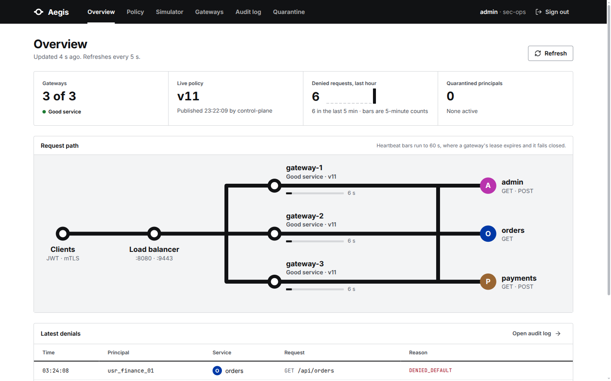
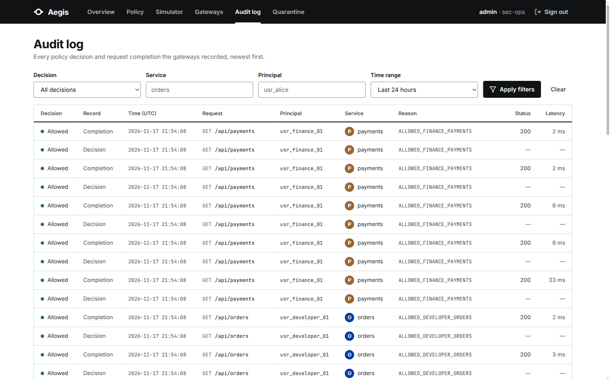
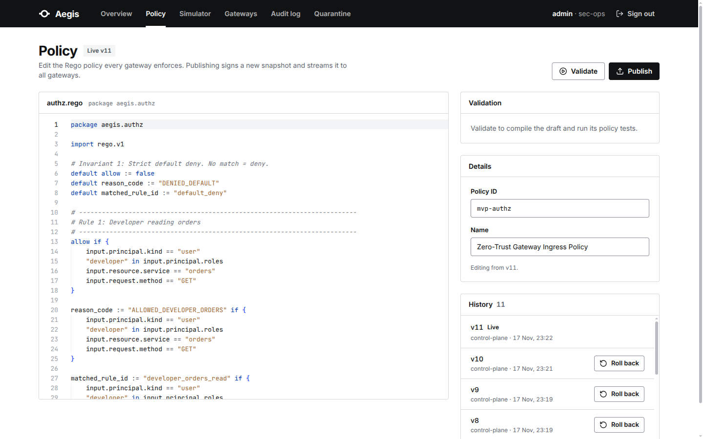
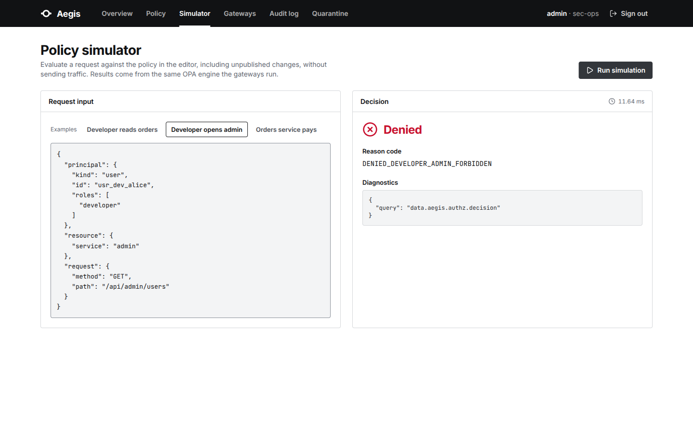
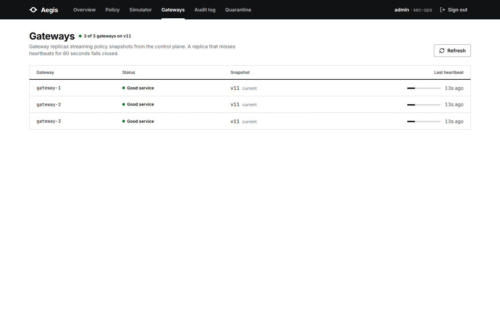
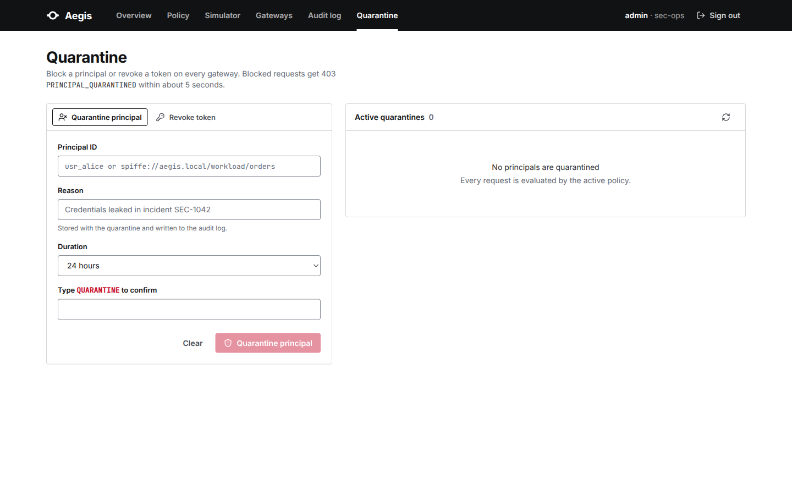
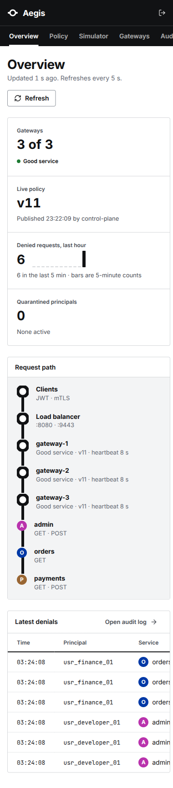
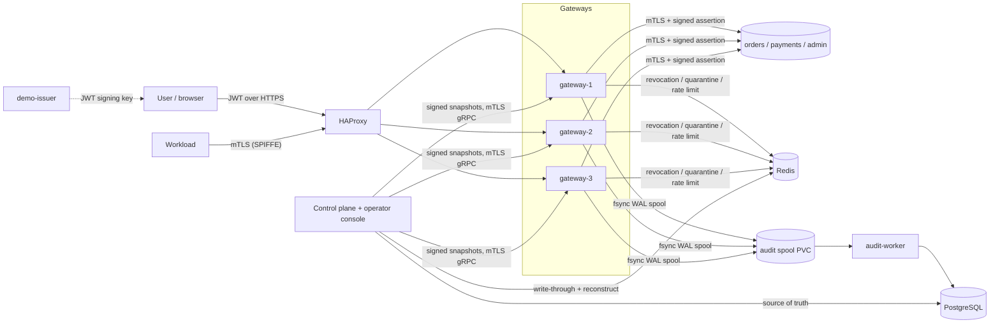

# Aegis — Distributed Zero-Trust Access Gateway

[](https://github.com/6sLOGAN78/Aegis/actions/workflows/ci.yml)


[](LICENSE)

Aegis is a reference implementation of a **zero-trust access gateway**: every request, from users and from services, is authenticated, authorized against a signed policy snapshot, durably audited, and only then forwarded to a backend that itself refuses anything that did not come through the gateway.

It is built as a portfolio-grade distributed system: a Go reverse proxy with an embedded OPA/Rego engine, a control plane that streams signed configuration snapshots over mutually authenticated gRPC, Redis-backed sub-5-second revocation and quarantine, a fsync'd write-ahead audit spool, and an operator dashboard — runnable as one container set on a laptop or as a 3-replica cluster behind a load balancer.

> **Status:** v1.0.1. Milestone v1.0 is complete (phases 0–13), and the gap-closure work is shipped. It is an educational reference system, not an audited security appliance. See [Known limitations](#known-limitations).



---

## Table of contents

- [Why Aegis](#why-aegis)
- [Features](#features)
- [Operator console](#operator-console)
- [Architecture](#architecture)
- [Policy rules](#policy-rules)
- [Security invariants](#security-invariants)
- [Repository structure](#repository-structure)
- [Getting started](#getting-started)
- [Deployment profiles](#deployment-profiles)
- [Using the system](#using-the-system)
- [Testing](#testing)
- [Operations](#operations)
- [Kubernetes](#kubernetes)
- [Development](#development)
- [Documentation](#documentation)
- [Known limitations](#known-limitations)
- [Contributing](#contributing) · [Security](#security) · [License](#license)

---

## Why Aegis

Perimeter security assumes that anything inside the network is trusted. Aegis assumes the opposite (NIST SP 800-207): network location is never authorization, every hop is authenticated, and a compromised service or stolen token can be cut off cluster-wide in seconds.

The project demonstrates the engineering that makes that practical:

- authorization decisions in tens of microseconds, with **no network calls on the hot path**;
- policy changes that roll out atomically and monotonically to every replica;
- failure modes that **fail closed** (Redis down, stale policy, full audit disk → `503`, never "allow");
- revocation state that survives losing Redis entirely.

## Features

| Area | What it does |
|---|---|
| **Gateway** | Go `httputil.ReverseProxy` with strict path canonicalization, header sanitization, request IDs, and two listeners: user traffic (`:8080`, JWT) and workload traffic (`:9443`, mTLS with SPIFFE URI SANs). |
| **Policy** | Embedded OPA/Rego evaluated in-memory against a typed request context. Default deny; routes bind a path+method to exactly one upstream. |
| **Identity** | Short-lived Ed25519 JWTs (pinned issuer/audience/alg) for users; `spiffe://aegis.local/...` client certificates for workloads; gateway→backend hops carry a signed short-lived assertion over mTLS. |
| **Bypass prevention** | Backends expose no host ports, require the gateway's client certificate **and** a valid gateway assertion. |
| **Control plane** | Versioned routes/policies with schema validation, a policy simulator, and Ed25519-signed snapshots streamed to gateways over **mTLS gRPC**; each gateway's identity is bound to its certificate (`/gw/<id>`), and replicas renew a 10 s freshness lease (fail closed after 60 s). |
| **Revocation & quarantine** | Token `jti` revocation and principal quarantine take effect on every replica in < 5 s. State is written **Postgres-first**, mirrored to Redis, and **reconstructed automatically after a Redis loss**; gateways fail closed (`SECURITY_STATE_MISSING`) until it is restored. |
| **Key rotation** | Gateways hot-reload JWT and snapshot trusted-key *directories* (poll + `SIGHUP`) — expand → switch signer → prune with zero downtime and no gateway restart. |
| **Audit** | Every permitted request is written to a local fsync'd WAL spool *before* it is forwarded; an audit worker ships it to PostgreSQL with idempotent, crash-safe delivery. Spool ≥ 90 % full → fail closed. |
| **Operations** | React/TypeScript operator console (policy studio, simulator, fleet topology, audit stream, emergency quarantine/revoke) on a CSRF-protected, role-gated `/control/v1` REST API; Prometheus metrics; SRE runbooks. |
| **Distribution** | 3 gateway replicas behind HAProxy with convergence tracking, graceful drain, and jittered reconnect backoff; chaos and DR drills in the test suite. |

## Operator console

The console is served by the control plane at `http://localhost:8084/dashboard/`. It is a React and TypeScript app that is built once and embedded in the Go binary, so it needs no separate web server. It is designed for an on-call operator who needs to know within seconds whether enforcement is healthy.

The design follows the high-performance HMI guidance used for control rooms (ISA-101):
- The base is neutral.
- Colour appears only for abnormal state, and always comes with a word and a mark shape.
- Each page states how fresh its data is before showing anything else.

The design system is documented in [DESIGN.md](DESIGN.md).

| Page | What it is for |
|---|---|
| **Overview** | Data freshness, a status board (gateways in service, live policy version, denials in the last hour, active quarantines), and the live request path drawn as a line diagram. A gateway that is late or behind on its snapshot is drawn as an open ring; one that is failing closed is drawn as a red square. |
| **Policy** | A Rego editor with validation against the policy tests, signed publish, and version history with rollback. |
| **Simulator** | Evaluates a request against the live policy or the unpublished draft, using the same OPA engine the gateways run. |
| **Gateways** | Each replica's status, its snapshot version, and its heartbeat age measured against the 60-second lease. |
| **Audit log** | Decision and completion records with filters and a detail drawer for each event. |
| **Quarantine** | Blocks a principal or revokes a token on every gateway within about 5 seconds. A typed confirmation is required. |

<table>
  <tr>
    <td width="50%"><br><sub><b>Audit log</b>: every decision and completion record, filterable by decision, service, principal and time range.</sub></td>
    <td width="50%"><br><sub><b>Policy</b>: edit Rego, validate against the policy tests, publish a signed snapshot, roll back.</sub></td>
  </tr>
  <tr>
    <td><br><sub><b>Simulator</b>: a developer opening the admin service is denied with <code>DENIED_DEVELOPER_ADMIN_FORBIDDEN</code>.</sub></td>
    <td><br><sub><b>Gateways</b>: replicas, snapshot convergence and heartbeat age against the fail-closed lease.</sub></td>
  </tr>
  <tr>
    <td><br><sub><b>Quarantine</b>: block a principal or revoke a token, with a typed confirmation.</sub></td>
    <td align="center"><br><sub><b>Phone</b>: the request path becomes a vertical line.</sub></td>
  </tr>
</table>

The screenshots come from the local `distributed` profile with real traffic sent through HAProxy. Sign in with `admin` / `admin-secret`, which is a development credential only.

## Architecture



**Request path** (user listener): canonicalize path → verify JWT → check revocation/quarantine in one Redis round trip → evaluate Rego against the active snapshot → append audit record to the WAL spool (fsync) → mint a backend assertion → forward over mTLS. Any failure along the way returns a structured `application/problem+json` denial with a reason code.

Design decisions are recorded as ADRs in [`docs/adr/`](docs/adr) — reverse-proxy architecture, in-memory OPA, dual-listener identity separation, signed freshness leases, Redis fail-closed semantics, and the pre-forward WAL audit spool.

## Policy rules

Authorization is a single Rego module, [`policies/rego/authz.rego`](policies/rego/authz.rego). It evaluates in memory on every gateway against the active signed snapshot. Each decision returns `allow`, a `reason_code` (written to the audit log) and the `snapshot_version` it was made under. Anything that matches no rule is denied.

| # | Rule | Principal | Service | Methods | Reason code |
|---|---|---|---|---|---|
| 0 | Default deny | anyone | any | any | `DENIED_DEFAULT` |
| 1 | Developer reads orders | user with role `developer` | orders | GET | `ALLOWED_DEVELOPER_ORDERS` |
| 2 | Developer reads payments | user with role `developer` | payments | GET | `ALLOWED_DEVELOPER_PAYMENTS` |
| 3 | Finance reads and creates payments | user with role `finance` | payments | GET, POST | `ALLOWED_FINANCE_PAYMENTS` |
| 4 | Application admin manages users | user with role `application-admin` | admin | any | `ALLOWED_ADMIN_USERS` |
| 5 | Orders workload creates payments | workload `spiffe://aegis.local/workload/orders` | payments | POST | `ALLOWED_WORKLOAD_ORDERS_PAYMENTS` |

Some denials are labelled explicitly so the audit log says why a request was refused:
- a developer calling admin gets `DENIED_DEVELOPER_ADMIN_FORBIDDEN`;
- the orders workload calling admin gets `DENIED_WORKLOAD_ADMIN_FORBIDDEN`;
- a request with no principal ID gets `DENIED_INVALID_PRINCIPAL`.

Before policy runs, the gateway also refuses requests:
- with a missing or invalid identity (`401`);
- from a quarantined principal or with a revoked token (`403 PRINCIPAL_QUARANTINED` / revoked `jti`);
- on a path that matches no route.

**Routes** ([`policies/data/routes.json`](policies/data/routes.json)) bind one method and path to exactly one upstream. Clients can never choose where a request goes.

| Route | Method | Path | Upstream | Rate limit (rps / burst) |
|---|---|---|---|---|
| `orders.list` | GET | `/api/orders` | `https://orders:8081` | 100 / 20 |
| `payments.get` | GET | `/api/payments` | `https://payments:8082` | 50 / 10 |
| `payments.create` | POST | `/api/payments` | `https://payments:8082` | 20 / 5 |
| `admin.users.list` | GET | `/api/admin/users` | `https://admin:8083` | 10 / 2 |
| `admin.users.manage` | POST | `/api/admin/users` | `https://admin:8083` | 5 / 1 |

Policy changes go through the console or the `/control/v1/policies` API:
1. Validate. The draft is compiled and [`policies/tests`](policies/tests) is run.
2. Simulate.
3. Publish. Publishing signs a new snapshot (Ed25519) and streams it to every gateway.
4. Roll back to any earlier version if needed.

Run the policy tests locally with `opa test policies/rego policies/tests`.

## Security invariants

The system is specified against twelve invariants, each backed by automated tests ([threat model](docs/threat-model/threat-model.md)):

1. Default deny across all routes
2. Verified identity only
3. Workload certificate authenticates, policy authorizes
4. TLS verification enabled everywhere
5. Backends accept only the gateway client identity + assertion
6. The route identifies the upstream (no client-controlled URLs)
7. Identical validated path/method and snapshot version across the decision
8. No header impersonation
9. Atomic snapshot activation with monotonic versioning
10. Permitted requests require a pre-forward durable audit record
11. Management access is separately authorized and audited
12. Network location is never authorization

## Repository structure

```text
.
├── api/
│   ├── openapi/            # /control/v1 OpenAPI spec (source of the generated REST types)
│   └── proto/              # gRPC snapshot distribution contract
├── benchmarks/             # Go policy-engine benchmarks and k6 load scripts
├── cmd/
│   ├── gateway/            # data-plane reverse proxy (user + workload listeners)
│   ├── control-plane/      # management API, operator console, snapshot gRPC server
│   ├── audit-worker/       # WAL spool → PostgreSQL shipper
│   ├── demo-issuer/        # development JWT issuer (dev only)
│   └── services/           # demo backends: orders, payments, admin
├── deployments/
│   ├── certs/              # DEV-ONLY PKI (root CA, server/client/workload certs)
│   ├── keys/               # DEV-ONLY JWT + snapshot signing keypairs and keyset dirs
│   ├── compose/            # mvp / hardened / distributed profiles, Dockerfile, HAProxy, seed
│   └── kubernetes/         # kustomize base + production overlay, secret bootstrap script
├── docs/
│   ├── adr/                # architecture decision records
│   ├── audit/              # security audit report
│   ├── runbooks/           # DR, credential rotation, quarantine, incident response, SLOs
│   └── threat-model/       # STRIDE threat model and invariants
├── internal/               # application packages (not importable outside the module)
│   ├── proxy/  policy/  identity/  revocation/  audit/  control/  snapshot/
│   ├── ratelimit/  keyset/  keyfile/  pki/  storage/  telemetry/  config/
│   └── testpki/            # in-memory PKI for hermetic mTLS tests
├── migrations/             # PostgreSQL schema migrations
├── pkg/api/                # generated gRPC + OpenAPI Go code (do not edit by hand)
├── policies/               # Rego policy, route/role seed data, JSON schemas, policy tests
├── scripts/                # cert/key generator, code generation, live compose smoke drill
├── services/middleware/    # backend-side mTLS + assertion verification middleware
├── tests/                  # integration, security, chaos, DR, rotation, failure, manifest tests
├── web/dashboard/          # React/TypeScript operator console (built assets are embedded)
└── Makefile                # all common workflows — run `make help`
```

## Getting started

### Prerequisites

| Tool | Version | Needed for |
|---|---|---|
| [Go](https://go.dev/dl/) | 1.26+ | building and testing |
| [Docker](https://docs.docker.com/get-docker/) + Compose v2 | Docker 24+, Compose 2.20+ | running the stack |
| [OPA](https://www.openpolicyagent.org/docs/latest/#running-opa) | 1.x | Rego policy tests |
| `make`, `curl`, `jq`, `openssl` | any recent | workflows and smoke drills |
| [Node.js](https://nodejs.org/) | 20+ | *only* to change the dashboard (built assets are committed) |
| `protoc`, `protoc-gen-go(-grpc)`, `oapi-codegen` | — | *only* to regenerate API code |

Keep at least ~15 GB of free disk: images are built locally, and the audit spool deliberately **fails closed when its disk is ≥ 90 % full**.

### Quick start (5 minutes)

```bash
git clone https://github.com/6sLOGAN78/Aegis.git
cd Aegis

# Build images and start the 3-replica cluster (gateways, control plane, Postgres, Redis, HAProxy)
make distributed-up

# Health
curl -s localhost:8084/readyz && echo   # control plane
curl -s localhost:8080/readyz && echo   # gateways via HAProxy
```

Open the operator console at **http://localhost:8084/dashboard/** and sign in with `admin` / `admin-secret`. It opens on the Overview; see [Operator console](#operator-console).

Tear everything down (including volumes) with `make distributed-down`.

### Recreating from scratch

The repository ships a working **development** PKI and keyset so the stack runs out of the box. To regenerate them:

```bash
make certs                                                # re-issue certs into deployments/certs
go run ./scripts/certificates -keys-dir deployments/keys  # certs + JWT/snapshot signing keys and keyset dirs
go run ./scripts/certificates -keypair /tmp/jwt-next      # one fresh Ed25519 keypair (for rotation drills)
```

The generator reuses `deployments/certs/root-ca.*` when present, so re-running it never rotates the CA; delete those two files first to mint a brand-new CA (every leaf is then re-issued from it). These keys are for local development only — production must provide its own (see [Kubernetes](#kubernetes)).

## Deployment profiles

| Profile | Command | What runs | Published ports |
|---|---|---|---|
| **mvp** | `make compose-up` | 1 gateway, control plane (internal only), demo backends, issuer, Postgres, Redis, audit worker | `8080` user, `9443` workload, `8085` issuer |
| **hardened** | `make up-hardened` | same services as mvp, with the control plane exposed to the host | above + `8084` console/API, `9090` gRPC |
| **distributed** | `make distributed-up` | 3 gateways behind HAProxy, 3 audit workers | `8080`/`9443` via HAProxy, `8404` HAProxy stats, `8084` console/API, `9090` gRPC, `9092` metrics |

Tear down with `make compose-down`, `make down-hardened`, or `make distributed-down`. Run one profile at a time — they share container names and ports.

## Using the system

Demo users (development credentials, overridable via `AEGIS_DEMO_PASSWORD_*`):

| User | Password | Principal | Role |
|---|---|---|---|
| `developer` | `demo-developer-pass` | `usr_developer_01` | developer |
| `finance` | `demo-finance-pass` | `usr_finance_01` | finance |
| `application-admin` | `demo-admin-pass` | `usr_admin_01` | application-admin |
| `admin` (console) | `admin-secret` | — | sec-ops |

Get a token and call a protected route (mvp/hardened publish the issuer on `:8085`):

```bash
TOKEN=$(curl -s -X POST localhost:8085/login -H 'Content-Type: application/json' \
  -d '{"username":"developer","password":"demo-developer-pass"}' | jq -r .access_token)

curl -s -H "Authorization: Bearer $TOKEN" localhost:8080/api/orders     # 200
curl -s localhost:8080/api/orders                                        # 401, problem+json
```

In the distributed profile the issuer is internal only; call it from inside a gateway container:
`docker compose -f deployments/compose/docker-compose.distributed.yml exec -T gateway-1 curl -s -X POST http://demo-issuer:8085/login ...`

From the console's **Emergency Quarantine** page you can quarantine a principal or revoke a token `jti`; every replica starts returning `403` within 5 seconds. `make compose-smoke PROFILE=<profile>` runs the full live drill (auth, audit, revocation, quarantine, DR, key rotation, mTLS) against a running profile.

## Testing

```bash
make test                 # unit tests (race detector) + OPA policy tests
make test-security        # negative security suite (path traversal, header spoofing, JWT attacks, RBAC)
make test-failure         # dependency failure and chaos scenarios
make manifest-test        # Kubernetes manifests cross-checked against the binaries
make compose-test         # compose profiles linted against the binaries (no Docker needed)
make test-e2e             # brings up mvp, runs integration tests, tears down
make bench                # in-memory policy evaluation benchmarks
```

Full hermetic suite, the same as CI:

```bash
go test -race -count=1 -p 1 ./...
opa test policies/rego policies/tests
```

Run packages serially (`-p 1`) on machines with limited free disk: the audit-spool tests use the real filesystem and correctly refuse writes above 90 % usage. `TestBackendBypassPrevention` and `TestMVPEndToEnd` need the mvp stack running; the bypass test also re-issues the dev leaf certificates in `deployments/certs` (restore with `git checkout deployments/certs`).

Measured policy evaluation is in the tens of microseconds per decision (≈ 40–70 µs on a laptop; `make bench`), well inside the 200 µs p50 budget.

## Operations

Runbooks in [`docs/runbooks/`](docs/runbooks):

| Runbook | Covers |
|---|---|
| [disaster-recovery.md](docs/runbooks/disaster-recovery.md) | Redis loss → automatic reconstruction from Postgres, the security-state marker, fail-closed window |
| [credential-rotation.md](docs/runbooks/credential-rotation.md) | expand / switch / prune for JWT and snapshot keys, TTL + 30 s overlap rule |
| [quarantine-and-revocation.md](docs/runbooks/quarantine-and-revocation.md) | emergency principal quarantine and token revocation via API or console |
| [spool-saturation-recovery.md](docs/runbooks/spool-saturation-recovery.md) | audit spool ≥ 90 % → fail closed, recovery steps |
| [control-plane-partition.md](docs/runbooks/control-plane-partition.md) | lease expiry behaviour when gateways lose the control plane |
| [incident-response.md](docs/runbooks/incident-response.md), [production-slo-checklist.md](docs/runbooks/production-slo-checklist.md) | incident flow and SLO gates |

Key health signals: `/livez` and `/readyz` on the gateway and control plane; Prometheus metrics such as `aegis_security_state_ready`, `aegis_keyset_reload_failing`, and gRPC identity-rejection counters.

## Kubernetes

Manifests live in [`deployments/kubernetes`](deployments/kubernetes) (kustomize base + `overlays/production`; namespaces enforce Pod Security `restricted`). The gateway runs as a StatefulSet with a PVC-backed audit spool and an audit-worker sidecar; each pod selects its own control-plane client certificate by pod name.

```bash
# Provide production certs/keys — never the repository's dev material
AEGIS_CERTS_DIR=/secure/certs AEGIS_KEYS_DIR=/secure/keys \
  deployments/kubernetes/secrets/create-secrets.sh

kubectl apply -k deployments/kubernetes/overlays/production
```

See [`deployments/kubernetes/secrets/README.md`](deployments/kubernetes/secrets/README.md) for the Secret/ConfigMap inventory. The manifests are verified by hermetic tests against the binaries; a live cluster bring-up has not yet been exercised (see limitations).

## Development

```bash
make help                          # every workflow target
make lint                          # gofmt check + go vet (what CI runs)
make generate                      # regenerate pkg/api from api/proto and api/openapi
make manifest-build                # render the kustomize base and production overlay
cd web/dashboard && npm ci && npm run build   # rebuild the console (output is embedded via go:embed)
cd web/dashboard && npm run dev               # console dev server on :5173, proxies /control/v1 to :8084
```

Conventions: Go code is `gofmt`/`go vet` clean; generated code under `pkg/api` is never edited by hand; every behaviour change ships with tests, including negative tests for security paths. See [CONTRIBUTING.md](CONTRIBUTING.md).

## Documentation

- [Threat model](docs/threat-model/threat-model.md) — actors, STRIDE analysis, invariants
- [Architecture decisions](docs/adr) — ADR 0001–0006
- [Security audit report](docs/audit/security-audit-report.md)
- [Runbooks](docs/runbooks)
- [DESIGN.md](DESIGN.md): operator console design system; [PRODUCT.md](PRODUCT.md): who the console is for
- [CHANGELOG](CHANGELOG.md) — milestone history

## Known limitations

Aegis is a reference system. Known, tracked gaps:

- **Development key material is committed** (`deployments/certs`, `deployments/keys`) so the stack runs out of the box. Treat it as public; never deploy it.
- **Postgres connections are not TLS-encrypted** (`sslmode=disable`).
- **Quarantine write serialisation is per process.** With more than one control-plane replica, a fresh quarantine can be lost for up to the 30 s reconcile interval; run a single control-plane replica.
- **Kubernetes bring-up is unverified on a live cluster**; manifests are checked hermetically only.
- The demo issuer is a development stand-in; production should delegate user authentication to an external OIDC provider.

## Contributing

Contributions are welcome — please read [CONTRIBUTING.md](CONTRIBUTING.md) first.

## Security

Please do **not** open public issues for vulnerabilities. See [SECURITY.md](SECURITY.md).

## License

[MIT](LICENSE) © 2026 Ayush Maurya
